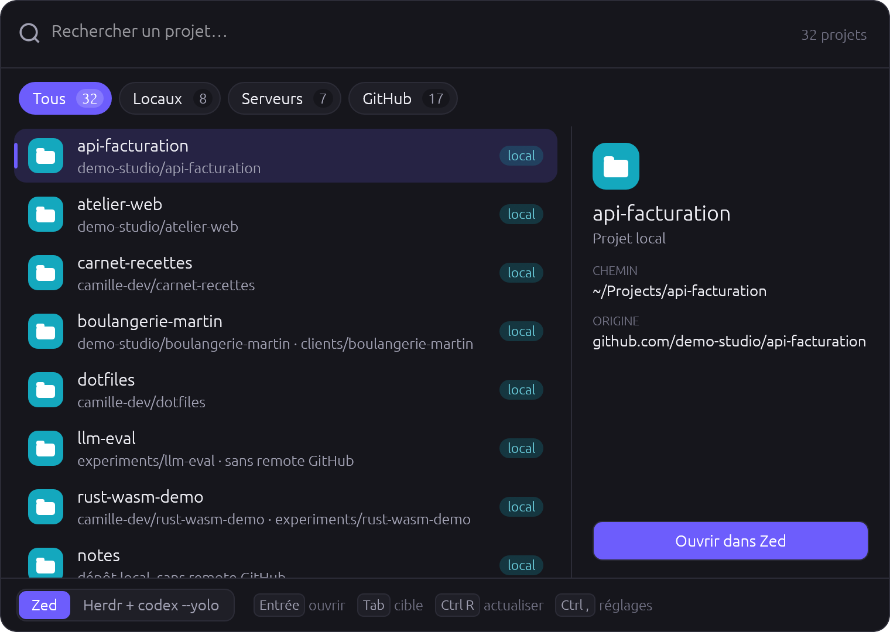

# zrepo-rs

Lanceur de projets pour **Linux**, **macOS** et **Windows**. Une fenêtre flottante
(dans l'esprit de Raycast ou Spotlight) réunit :

- vos **projets locaux** (le dossier des projets, `~/Projects` par défaut) ;
- vos **projets distants**, déclarés dans les `ssh_connections` de Zed ;
- vos **dépôts GitHub** (les vôtres, ceux où vous êtes collaborateur et ceux de vos organisations).

Tapez quelques lettres (recherche floue) puis Entrée : le projet s'ouvre dans la cible de
votre choix :

- un **terminal** ouvert dans le dossier du projet (Windows Terminal ou PowerShell, Terminal.app,
  votre terminal Linux) ;
- **votre éditeur** : VS Code, Cursor, Windsurf, Sublime Text et les IDE JetBrains sont détectés,
  et n'importe quel autre exécutable s'ajoute depuis l'assistant ;
- **Zed** ;
- **Herdr** avec un agent (`codex --yolo`), hors Windows.

Un dépôt GitHub absent en local est cloné d'abord, sans passer par `gh`.

`zrepo-rs` est une application distincte de l'ancien `zrepo`. Son exécutable,
sa configuration, son cache, son entrée de trousseau et ses raccourcis portent
tous le nom `zrepo-rs` : l'installation ne remplace ni ne modifie l'ancienne
application.



Autres captures du lanceur (thème clair, clonage et erreurs) :
[docs/screenshots](docs/screenshots).

## Installation

### Linux et macOS

```sh
curl -fsSL https://github.com/jpierre-amar/zrepo-rs/releases/latest/download/install.sh | sh
```

L'installeur :

1. détecte le système et l'architecture (Linux x86_64 ou aarch64, macOS Intel ou Apple Silicon) ;
2. télécharge l'archive de la dernière release et **vérifie sa somme SHA-256** ;
3. demande le dossier d'installation (`~/.local/bin` par défaut) ;
4. sous Linux, ajoute `zrepo-rs` au menu des applications (`~/.local/share/applications/zrepo-rs.desktop`
   et l'icône dans `~/.local/share/icons/hicolor/256x256/apps/`) ;
5. sous macOS, crée `~/Applications/zrepo-rs.app` et retire l'attribut de quarantaine
   (`xattr -dr com.apple.quarantine`), car le binaire n'est pas notarisé ;
6. signale si le dossier n'est pas dans le `PATH` et propose d'ajouter la ligne à votre
   fichier de shell (seulement si vous répondez « o ») ;
7. lance l'assistant `zrepo-rs setup`.

Il n'utilise jamais `sudo`. Options, à passer après `sh -s --` :

```sh
curl -fsSL https://github.com/jpierre-amar/zrepo-rs/releases/latest/download/install.sh \
  | sh -s -- --yes --dir ~/bin --version v0.2.0 --no-setup
```

| Option | Variable | Effet |
|---|---|---|
| `-y`, `--yes` | | aucune question, valeurs par défaut |
| `--dir <chemin>` | `ZREPO_RS_INSTALL_DIR` | dossier du binaire |
| `--version <vX.Y.Z>` | `ZREPO_RS_VERSION` | version précise au lieu de la dernière |
| `--no-setup` | | ne lance pas l'assistant |

### Windows

Téléchargez **`zrepo-rs-setup-x86_64.exe`** depuis la
[dernière release](https://github.com/jpierre-amar/zrepo-rs/releases/latest) et lancez-le.
L'installation se fait pour votre compte, **sans droits administrateur** :

1. `zrepo-rs.exe` dans `%LOCALAPPDATA%\Programs\zrepo-rs` ;
2. un raccourci dans le menu Démarrer (et sur le Bureau si vous le demandez) ;
3. l'ajout au `PATH` de l'utilisateur (case cochée par défaut), pour la commande `zrepo-rs` ;
4. une entrée dans **Paramètres → Applications installées**, pour désinstaller ;
5. le lancement de l'assistant `zrepo-rs setup` à la fin.

Le setup n'est pas signé : Windows SmartScreen peut afficher « Windows a protégé votre
ordinateur ». Cliquez sur « Informations complémentaires » puis « Exécuter quand même ».
Installation silencieuse : `zrepo-rs-setup-x86_64.exe /VERYSILENT /TASKS=addtopath`.
Seul Windows x64 est pris en charge pour l'instant.

#### Par script PowerShell

Pour les scripts et le déploiement, dans PowerShell (5.1 ou 7) :

```powershell
irm https://github.com/jpierre-amar/zrepo-rs/releases/latest/download/install.ps1 | iex
```

Le script télécharge l'archive, vérifie sa somme SHA-256, installe `zrepo-rs.exe` au même
endroit que le setup (le dossier est demandé), ajoute ce dossier au `PATH` de l'utilisateur,
crée un raccourci dans le menu Démarrer puis lance `zrepo-rs setup`.

Avec des paramètres (`-Yes`, `-Dir`, `-Version`, `-NoSetup`) :

```powershell
& ([scriptblock]::Create((irm https://github.com/jpierre-amar/zrepo-rs/releases/latest/download/install.ps1))) -Yes -NoSetup
```

Les variables `ZREPO_RS_INSTALL_DIR` et `ZREPO_RS_VERSION` fonctionnent aussi.

### Vérification manuelle

Chaque release publie `zrepo-rs-<cible>.tar.gz` (ou `.zip`), le setup Windows
`zrepo-rs-setup-x86_64.exe`, le fichier `.sha256` de chacun et un récapitulatif `SHA256SUMS`.
Cibles : `x86_64-unknown-linux-gnu`, `aarch64-unknown-linux-gnu`, `x86_64-apple-darwin`,
`aarch64-apple-darwin`, `x86_64-pc-windows-msvc`.

### Depuis les sources

```sh
cargo install --git https://github.com/jpierre-amar/zrepo-rs zrepo-rs
```

Sous Linux, il faut les en-têtes système d'eframe (winit, OpenGL/EGL), de GTK 3 et de D-Bus (sous Debian ou Ubuntu :
`pkg-config libxkbcommon-dev libwayland-dev libxcb-render0-dev libxcb-shape0-dev libxcb-xfixes0-dev libgl1-mesa-dev libgtk-3-dev libdbus-1-dev`).

## Premier lancement : l'assistant

Au premier lancement (ou avec `zrepo-rs setup`), l'assistant vous guide :

1. **Dossier des projets**, choisi avec le sélecteur du système (`~/Projects` par défaut).
2. **GitHub** : connexion par le navigateur (un code s'affiche, le bouton « Copier et ouvrir
   github.com » fait le reste), ou un jeton personnel collé, ou le jeton de `gh` s'il est connecté,
   ou « Plus tard ». Le jeton est rangé dans le **trousseau du système** (service `zrepo-rs`,
   compte `github`), jamais dans un fichier.
3. **Cibles** : outils détectés (Zed, Herdr, terminal, éditeurs connus), ajout de vos propres
   éditeurs (« Ajouter un éditeur… » puis choix de l'exécutable), cible par défaut.
4. **Raccourci clavier** (voir plus bas).
5. Enregistrement de `config.toml`.

## Utilisation

| Commande | Effet |
|---|---|
| `zrepo-rs` | ouvre la fenêtre de lancement |
| `zrepo-rs setup` | relance l'assistant |
| `zrepo-rs list [--refresh]` | liste au format TSV |
| `zrepo-rs open <clé> [--with <cible>]` | ouvre un projet sans la fenêtre |
| `zrepo-rs doctor` | diagnostic (dépendances, cibles détectées, GitHub) |

Cibles de `--with` : `zed`, `herdr`, `terminal`, `vscode`, `cursor`, `windsurf`, `sublime`,
`idea`, `pycharm`, `webstorm`, `phpstorm`, `rustrover`, ou le nom d'un éditeur que vous avez
ajouté. Sans `--with`, la cible par défaut est utilisée. Les projets distants (`ssh://`)
s'ouvrent seulement dans Zed ou Herdr.

Dans la fenêtre : **Entrée** ouvre, **Ctrl-E** ouvre dans Zed, **Ctrl-Y** dans Herdr,
**Ctrl-T** dans un terminal, **Tab** change de cible, **Ctrl-R** rafraîchit,
**Ctrl-1** à **Ctrl-4** choisissent le filtre
(Tous, Locaux, Serveurs, GitHub), **Ctrl-,** ouvre les réglages, **Échap** ferme.
Faites glisser la poignée à six points, à gauche du champ de recherche, pour déplacer la fenêtre.
La fenêtre se ferme aussi quand elle perd le focus, sauf pendant un clonage ou
quand une erreur est affichée.

## Configuration

Le fichier `config.toml` se trouve dans :

| Système | Emplacement |
|---|---|
| Linux | `~/.config/zrepo-rs/config.toml` |
| macOS | `~/Library/Application Support/zrepo-rs/config.toml` |
| Windows | `%APPDATA%\zrepo-rs\config\config.toml` |

```toml
projects_dir = "/home/moi/Projects"
scan_depth = 3
cache_ttl = 600                 # secondes

[github]
enabled = true

[remote]
enabled = true
zed_settings = ""               # vide = emplacement Zed par défaut
scan_depth = 3
ssh_timeout = 8

[herdr]
enabled = true
agent = "codex"
args = ["--yolo"]
wait = 20

[ui]
default_target = "terminal"     # "zed", "herdr", "terminal", "vscode", ou le nom d'un éditeur

[terminal]                      # facultatif : vide = détection automatique
command = ""                    # par ex. "wezterm", ou un chemin complet
args = []                       # {path} = dossier du projet ; le terminal y démarre de toute façon

[[editors]]                     # autant de blocs que d'éditeurs ajoutés
name = "Mon IDE"
command = 'C:\outils\ide.exe'   # chemin complet, ou un nom présent dans le PATH
args = ["--new-window", "{path}"]   # sans {path}, le dossier est ajouté à la fin
```

Un éditeur ajouté porte le nom d'un éditeur connu (« VS Code »…) ? Votre déclaration remplace
la détection automatique.

Les variables d'environnement ont priorité sur le fichier : `ZREPO_RS_PROJECTS_DIR`,
`ZREPO_RS_CACHE_TTL`, etc. Pour GitHub, `GITHUB_TOKEN` ou `ZREPO_RS_GITHUB_TOKEN` passent avant
le trousseau, lui-même avant `gh auth token`.

## Raccourci clavier

Pointez le raccourci vers le chemin complet du binaire si son dossier n'est pas dans le
`PATH` de votre session graphique (par exemple `~/.local/bin/zrepo-rs`).

**Hyprland** (`~/.config/hypr/hyprland.conf` ou `bindings.conf`) :

```ini
bindd = SUPER, R, Projets (zrepo-rs), exec, zrepo-rs
```

**Omarchy** (configuration Lua, `~/.config/hypr/bindings.lua`) :

```lua
o.bind("SUPER + R", "Projets (zrepo-rs)", "zrepo-rs")
```

**Règle de fenêtre sous Hyprland.** La fenêtre de lancement n'a pas de décoration : elle
dessine elle-même ses coins arrondis et son ombre, et sa classe (app_id) est `zrepo-rs`.
Hyprland doit la faire flotter et la centrer, sans bordure ni ombre du compositeur.
L'étape « Raccourci clavier » de `zrepo-rs setup` propose d'ajouter ces lignes (aperçu,
puis écriture seulement après un clic sur « Appliquer », avec une copie
`<fichier>.bak.<horodatage>`). Configuration Lua (`~/.config/hypr/hyprland.lua`) :

```lua
hl.window_rule({
    match = { class = "^zrepo-rs$" },
    float = true, center = true, tag = "-default-opacity", opacity = "1 1",
})
hl.window_rule({ match = { class = "^zrepo-rs$", title = "^zrepo-rs$" }, border_size = 0, rounding = 0, no_shadow = true, no_blur = true })
```

Ancien format `hyprland.conf` (Hyprland 0.53 et plus récent) :

```ini
windowrule = float on, center on, opacity 1 1, match:class ^zrepo-rs$
windowrule = border_size 0, rounding 0, no_shadow on, no_blur on, match:class ^zrepo-rs$, match:title ^zrepo-rs$
```

(avant 0.53 : `windowrulev2 = float, class:^(zrepo-rs)$`, puis `center`, `noborder`,
`rounding 0`, `noshadow` et `noblur` sur `class:^(zrepo-rs)$, title:^(zrepo-rs)$`).

**GNOME** : Paramètres → Clavier → Raccourcis personnalisés → « + », commande
`zrepo-rs`. Choisissez une combinaison encore libre afin de conserver le
raccourci de l'ancien `zrepo`. La modification manuelle par `gsettings` n'est
pas proposée ici, car réécrire la liste complète peut supprimer des raccourcis
existants.

**KDE Plasma** : Configuration du système → Clavier → Raccourcis → « Ajouter une application »
→ zrepo-rs, puis attribuez Meta+R.

**macOS** : app **Raccourcis** → nouveau raccourci → action « Ouvrir l'app » → `zrepo-rs`
(dans `~/Applications`) ; puis, dans les détails du raccourci, « Ajouter un raccourci clavier ».

**Windows** : menu Démarrer → clic droit sur zrepo-rs → Ouvrir l'emplacement du fichier →
clic droit sur le raccourci → Propriétés → champ « Touche de raccourci » (par exemple Ctrl+Alt+R).

## Désinstallation

Linux :

```sh
rm -f ~/.local/bin/zrepo-rs ~/.local/share/applications/zrepo-rs.desktop \
      ~/.local/share/icons/hicolor/256x256/apps/zrepo-rs.png
rm -rf ~/.config/zrepo-rs ~/.cache/zrepo-rs          # configuration et cache (facultatif)
```

macOS :

```sh
rm -f ~/.local/bin/zrepo-rs
rm -rf ~/Applications/zrepo-rs.app
rm -rf ~/Library/Application\ Support/zrepo-rs ~/Library/Caches/zrepo-rs   # facultatif
```

Windows, installé par le setup : **Paramètres → Applications → Applications installées →
zrepo-rs → Désinstaller**. La configuration, le cache et le jeton GitHub sont conservés ;
supprimez `%APPDATA%\zrepo-rs` et `%LOCALAPPDATA%\zrepo-rs` pour les effacer.

Windows, installé par `install.ps1` (PowerShell) :

```powershell
$d = "$env:LOCALAPPDATA\Programs\zrepo-rs"
Remove-Item -Recurse -Force $d
Remove-Item -Force "$([Environment]::GetFolderPath('Programs'))\zrepo-rs.lnk"
$p = ([Environment]::GetEnvironmentVariable('Path','User') -split ';' | Where-Object { $_ -and $_ -ne $d }) -join ';'
[Environment]::SetEnvironmentVariable('Path', $p, 'User')
Remove-Item -Recurse -Force "$env:APPDATA\zrepo-rs", "$env:LOCALAPPDATA\zrepo-rs" -ErrorAction SilentlyContinue  # facultatif
```

Adaptez les chemins si vous avez choisi un autre dossier. Retirez aussi la ligne `# zrepo-rs`
ajoutée à votre fichier de shell, et le jeton du trousseau (entrée `zrepo-rs` / `github`).

## Pour le mainteneur

Les procédures de développement, de vérification et de publication sont
regroupées dans [docs/DEVELOPMENT.md](docs/DEVELOPMENT.md). Les garanties qui
empêchent toute modification de l'ancien `zrepo` sont détaillées dans
[docs/COEXISTENCE.md](docs/COEXISTENCE.md).

### Client OAuth GitHub (connexion par le navigateur)

1. GitHub → **Settings** → **Developer settings** → **OAuth Apps** → **New OAuth App**.
2. Nom : `zrepo-rs` ; Homepage URL et Authorization callback URL : `https://github.com/jpierre-amar/zrepo-rs`
   (le Device Flow n'utilise pas le callback, mais le champ est obligatoire).
3. Cochez **Enable Device Flow**, enregistrez, puis copiez le **Client ID**. Aucun client secret
   n'est nécessaire : n'en générez pas.
4. Dans le dépôt : **Settings** → **Secrets and variables** → **Actions** → **New repository secret**,
   nom `ZREPO_RS_GITHUB_CLIENT_ID`, valeur : le Client ID.

Le Client ID est compilé dans le binaire (`option_env!`). Sans lui, la release se construit quand
même (avec un avertissement) et l'assistant propose seulement le jeton personnel ou celui de `gh`.

Pour un build local avec la connexion par le navigateur :

```sh
ZREPO_RS_GITHUB_CLIENT_ID=<client_id> cargo build --release -p zrepo-rs
```

### Variables de débogage de l'interface

Non documentées dans `--help`, elles servent aux captures d'écran et aux tests manuels :

| Variable | Effet |
|---|---|
| `ZREPO_RS_DEBUG_SETUP_STEP=n` | l'assistant s'ouvre directement à l'étape n (1 à 6 ; l'étape 6 enregistre `config.toml`) |
| `ZREPO_RS_DEBUG_KEEP_OPEN=1` | le lanceur ne se ferme pas quand il perd le focus |
| `ZREPO_RS_DEBUG_QUERY=texte` | recherche pré-remplie |
| `ZREPO_RS_DEBUG_THEME=light` ou `dark` | force le thème (sinon : `gsettings` sous Linux, le système ailleurs) |
| `ZREPO_RS_DEBUG_DEVICE_CODE=ABCD-1234` | affiche l'écran du code GitHub sans contacter GitHub (binaire compilé avec un client OAuth) |

### Publier une version

1. Mettez à jour `version` dans `[workspace.package]` du `Cargo.toml` racine (le workflow
   refuse un tag qui ne correspond pas).
2. Puis :

```sh
git tag v0.2.0 && git push --tags
```

Le workflow `release.yml` compile les 5 cibles, construit le setup Windows avec Inno Setup
(`packaging/windows/zrepo-rs.iss`), publie les archives, le setup, leurs `.sha256`, `SHA256SUMS`,
`install.sh`, `install.ps1` et les fichiers d'intégration (`zrepo-rs.desktop`, `zrepo-rs.png`, `zrepo-rs.ico`,
`Info.plist.in`). Un tag contenant un tiret (`v0.3.0-rc.1`) donne une pré-release.

Pour retirer une release défectueuse : supprimez-la sur GitHub (ou marquez la précédente comme
« Latest ») ; `releases/latest` pointe alors de nouveau vers la version saine.

## Licence

MIT, voir [LICENSE](LICENSE).
